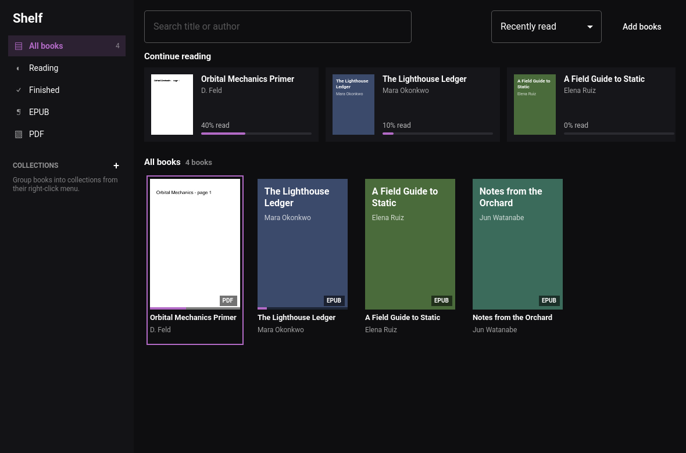

# Shelf

An organized library and reader for EPUB and PDF books, built for Omarchy.



- **Library** of covers you can search, sort (recently read, title, author,
  date added), and narrow to *Reading*, *Finished*, *EPUB*, *PDF*, or your own
  **collections**. Books you're in the middle of wait under *Continue reading*.
- **Tabs.** Open several books at once; each keeps its place, and open tabs
  come back the next time Shelf starts.
- **Outline sidebar** with the book's cover and progress, a collapsible table
  of contents, and page thumbnails for PDFs.
- **EPUB reader** built on [foliate-js](https://github.com/johnfactotum/foliate-js):
  one or two pages or scrolling, text size, book/serif/sans fonts, and White,
  Sepia, Green, Night, and Black themes. The footer shows minutes left in the
  chapter and a slider to jump anywhere.
- **PDF reader** on Qt's own PDF engine: scroll through the pages or turn them
  one at a time, side to side or top to bottom, with a scroll speed of your
  choosing, plus zoom, find, and a page box to jump straight to a page.
- **Select several books** (the *Select* button, Ctrl-click, Shift-click, or
  Ctrl+A) to add them to a new or existing collection at once, mark them
  finished, or remove them.
- **Numbered outlines.** Every outline is numbered — 14, 14.2, 14.2.1 —
  keeping the numbers a book prints and filling in the rest.
- **Learn Shelf**, in the library's sidebar: a five-minute course with a
  practice book to try everything on.
- **Clean up scanned pages** (PDF *View* menu): *Clean* turns yellowed or
  gray paper white and the text dark; *Clean + sharpen* also crisps up blurry
  scans, more for blurrier pages, and handles light-on-dark pages too. Both
  straighten tilted pages, paint out dark scanner edges, and even out spine
  shadows. Cleaned pages are kept in `~/.cache/shelf/pages/` (up to 400 MB),
  and the pages ahead of you are cleaned in the background. The file is
  never changed.
- **Text versions of scanned books** (PDF *View* menu → *Make a text
  version*): a clean EPUB that reflows with your colours and text size,
  chapters and numbered headings from the outline, figures and tables kept
  as pictures. It is added to the library as its own book, so highlights,
  notes, and Ask AI work on it too.
- **Highlights and notes.** Select text in an EPUB or PDF (drag, or double-
  and triple-click for a word or sentence) to highlight it in
  one of four colors, add a note, or copy it; click a highlight to change or
  remove it. Bookmark any page and write notes on PDF pages. Ctrl+Z undoes a
  change, a deleted bookmark or highlight included. The
  **Notes** tab in the sidebar lists everything under the outline's
  chapters (collapsible), with each note's section, long notes folded, search,
  *Copy all*, and *Export* to Markdown in `Documents/Shelf`, organised by the
  outline's chapters and sections.
- **AI outlines, on your own computer.** A PDF with no outline (a scanned
  book, say) can have one built by a local model through
  [Ollama](https://ollama.com): Shelf reads every page, OCRs pages that are
  only a picture with tesseract, lines up the printed contents with the PDF's
  pages, and fills in chapters as the model finds them. Nothing leaves the
  machine, and the rest of Shelf works without it. Building runs in the
  background at idle priority, one page at a time with rests in between, so
  it never makes the computer hot or slow while you read. Reference manuals whose
  pages are numbered by chapter ("12-3") get their printed structure read
  straight from the pages instead: topics, chapters, every section in each
  chapter's contents list, and named equations as subsections.
- **Ask AI about a passage.** Select text (or click a highlight) and press
  *Ask AI* to have it explained, summarized, or turned into flashcards, or to
  ask your own question. The answer streams in beside the page, and *Save to
  notes* keeps it with the highlight, marked as written by AI. *Quiz me*
  answers become flashcards with one click.
- **Ask this book** (Ctrl+K, or the button in the reader): ask anything about
  the whole book. Shelf finds the passages that answer it and the local model
  answers from them, citing each as [1], [2]; click a citation to go there.
- **Practice tests**: right-click a chapter in the outline (or use *Practice
  test* in Ask this book), choose how many questions and what kind, and the
  local model writes them from that chapter's text. Multiple choice is marked
  at once; free answers are marked by the model, which only credits what you
  actually wrote. Missed questions can become flashcards.
- **Hands-on questions**: Shelf decides which kind fits the chapter.
  - *Code* (programming): write a function in Python or JavaScript; it is
    run against tests, some hidden.
  - *Markov chains* (probability): build a chain on a diagram, or work out
    its long-run or n-step probabilities.
  - *Molecules* (chemistry, biochemistry): draw the structure, with ring
    templates and implied hydrogens; any correct drawing matches, laid out
    however you like, and a wrong one shows the answer beside it.
  - *Scenarios* (formulas in physics, engineering, finance): work out a
    value, or move a slider to find a break-even point or a peak, with live
    results and a chart.

  Shelf checks these itself rather than trusting the model: it runs the
  model's own code solution and drops tests it fails, computes Markov and
  formula answers (dropping questions whose stated answer disagrees), and
  checks a molecule's SMILES against its formula. Code runs inside the web
  view's sandbox, in a worker that is stopped after a few seconds and can't
  reach the network or your files. Python is Pyodide, downloaded and checked
  by `bin/build` and installed in `/usr/share/shelf/pyodide`.
- **Search all books** (Ctrl+Shift+F, or the library's sidebar) finds words
  inside every book, with the words around each match; click one to open the
  book there. Scanned books are searchable once their outline is built.
- **Knowledge graph** (library sidebar, or *Graph* in a book's Notes tab):
  your books, their chapters, your highlights and notes, and the concepts
  they share, as an animated graph. Type `[[a concept]]` in a note to link
  it, or press *Find concepts* to have the local model pick out the key
  ideas of each passage once (it reuses the same words, so the same idea in
  two books becomes one node, shown in teal). Hover to see what connects,
  click for details, open any passage in its book. It moves only while it
  settles, then costs nothing.
- **Updates** (*About Shelf* in the sidebar): Shelf can check GitHub once a
  day for a new version, only if you turn that on, or when you press *Check
  now*. Updating verifies the download against the release's SHA-256
  checksums, then installs it with pacman (asking for your password) on
  Arch, or runs the installer on Windows; you can skip a version.
- **Review flashcards** from the library's sidebar: spaced repetition (SM-2),
  so cards you know come back after longer and longer gaps and ones you
  missed come back the same session. Space shows the answer; 1–4 grade it.
- **Tabs like a browser's.** Drag a book's tab to move it; right-click it to
  close it, the others, or those to its right.
- **Your place is kept** for every book and restored when you reopen it.
- **Your files stay put.** Shelf remembers where books are and never writes to
  them. Removing a book from the library leaves the file alone.
- **One window.** Opening a book from the file manager while Shelf runs hands it
  to the open window.

Add books with Ctrl+O (through the desktop's file chooser), by dropping files
or whole folders on the window, or by opening them with Shelf.

## Shortcuts

| Key | Library | Reading |
| --- | --- | --- |
| `Ctrl+O` | Add books | |
| `/` | Search | |
| Arrows, `Enter` | Move between books, open one | Turn the page |
| `PgUp` / `PgDn`, `Space` | | Turn the page |
| `S` | Change sort order | |
| `Ctrl+N` | New collection | |
| `Delete` | Remove from library | |
| `T` | | Show or hide the outline |
| `B` | | Bookmark this page |
| `N` | | Notes (EPUB) / note on this page (PDF) |
| `Ctrl+C` | | Copy the selected text |
| `Ctrl+Z` / `Ctrl+Shift+Z` | | Undo / redo a highlight, note, or bookmark |
| `Ctrl+G` | | Go to page (PDF) |
| `Ctrl+Tab` / `Ctrl+Shift+Tab` | Next / previous tab | Next / previous tab |
| `Ctrl+W` | | Close tab |
| `Ctrl+1` … `Ctrl+9` | Library, then tabs in order | Same |
| `Ctrl +` / `Ctrl −` / `Ctrl+0` | | Text size (EPUB) or zoom (PDF) |
| `Ctrl+F` | | Find (PDF) |
| `Esc` | Clear search | Back to the library tab |
| `F11` | Full screen | Full screen |
| `?` | Shortcuts | Shortcuts |
| `Q` | Quit | |

## Build

```sh
bin/build     # build/shelf
bin/test      # unit tests, offscreen
bin/install   # makepkg -fsi: installs the binary, launcher entry, and icon
```

To try the hands-on tools without a model, point `SHELF_PRACTICE_FILE` at a
JSON file of questions in the model's format (`{"questions": [...]}`); the
next practice test uses those. `SHELF_DEBUG_AI=1` prints what the model
wrote.

Needs `qt6-base`, `qt6-declarative`, `qt6-webengine` (which also provides
Qt PDF), `qt6-webchannel`, and `zlib`.

`SHELF_UPDATE_API=http://127.0.0.1:8765` points the updater at a stand-in
for GitHub's API, and `SHELF_UPDATE_DRY_RUN=1` goes through an update
without installing it.

### Windows

Built by GitHub Actions (`.github/workflows/release.yml`) with MSVC, Qt
6.8 (WebEngine, PDF, WebChannel), zlib from vcpkg, `windeployqt`, and Inno
Setup (`windows/shelf.iss`). The installer needs no administrator, installs
for the current user, and offers Shelf for `.epub` and `.pdf` in *Open
with*. On Windows, files are picked with Windows' own Open dialog, and
tesseract is found in `C:\Program Files\Tesseract-OCR` if it isn't on the
PATH. To build by hand: install Qt with those modules, `vcpkg install
zlib:x64-windows`, then `qmake shelf.pro && nmake` from a Visual Studio
prompt.

### Releasing

```sh
bin/bump 0.2.0                  # shelf.pro and PKGBUILD
$EDITOR release-notes/v0.2.0.md # shown in Shelf before updating
git commit -am "Shelf 0.2.0" && git tag v0.2.0 && git push --follow-tags
```

The workflow tests and builds the Arch package and the Windows installer,
then publishes them with `SHA256SUMS`. The updater looks for releases of
the repository named `SHELF_REPO` in `shelf.pro`.

## Local AI (optional)

Install Ollama, then pick a model under *Local AI* in the library's sidebar
(Shelf downloads it), and press *Build outline* in a PDF's Outline tab:

```sh
sudo pacman -S ollama-cuda tesseract tesseract-data-eng   # or ollama / ollama-rocm
sudo systemctl enable --now ollama
ollama pull qwen3:8b
```

*Local AI* in the library's sidebar shows whether Ollama is installed and
running, picks the model, tests it, and chooses between the graphics card
(fast) and the processor only (leaves the graphics card free). Any installed
chat model works. Set `SHELF_OLLAMA_URL` to use Ollama on another address.

## Where things live

- Library: `~/.local/share/shelf/library.json`, written atomically.
- Highlights, notes, and bookmarks: `~/.local/share/shelf/annotations/`, one
  file per book. They stay when a book is removed and return if it is added
  again.
- Concepts found for the knowledge graph: `~/.local/share/shelf/concepts.json`.
- Flashcards: `~/.local/share/shelf/cards.json`.
- Downloaded updates: `~/.cache/shelf/updates/`.
- Covers: `~/.cache/shelf/covers/`, safe to delete; they come back when a book
  is added again.
- Flashcards: `~/.local/share/shelf/cards.json`.
- Book text for search and Ask this book: `~/.cache/shelf/search/`, safe to
  delete.
- Text versions: `~/.local/share/shelf/text versions/`.
- AI outlines: `~/.local/share/shelf/outlines/`, one file per book; the page
  text they were built from is cached in `~/.cache/shelf/text/`.

## License

MIT. See `LICENSE`, including the credits for foliate-js and Omacut.
